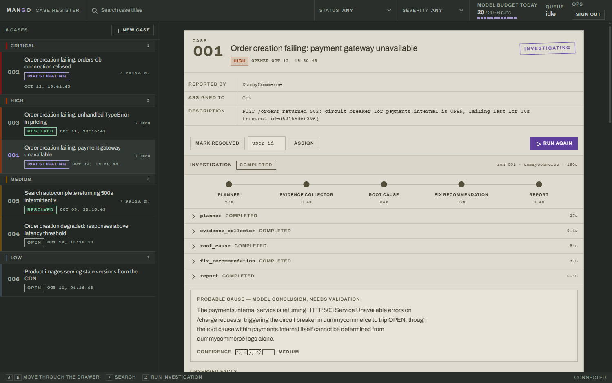

# Mango

AI-assisted incident management and investigation for software and SRE teams.

Mango stores incidents, keeps an audit timeline, notifies the people responsible, and runs a
multi-agent LangGraph investigation that reads real application logs and produces an
evidence-backed report. Incident management works fully on its own: if every AI and AWS
integration is unavailable, engineers can still run incidents through Mango.



## Features

- **Auth** — registration, login, JWT bearer tokens, `/auth/me`. Passwords stored as argon2
  hashes and never returned by the API.
- **Incidents** — create, read, list with filtering and pagination, assign/reassign, and a
  guarded status lifecycle (`OPEN -> INVESTIGATING -> RESOLVED`, no skipping or going back).
- **Comments** — any engineer can comment; only the author can edit or delete.
- **Activity timeline** — an append-only record of what happened to an incident, written in
  the same transaction as the change it describes.
- **Notifications** — incident creation publishes to AWS SNS, best-effort: an SNS outage can
  never cost you an incident.
- **Persisted investigations** — every run is a `WorkflowRun` with one `AgentExecution` per
  agent, so a failure is visible and explainable rather than silent.
- **AI investigation** — a LangGraph pipeline that plans, collects log evidence, diagnoses,
  recommends fixes, and assembles a report that separates collected facts from model
  conclusions.
- **DummyCommerce** — a companion app that fails on demand and leaves behind the log
  sequence a real failure would (pool warnings, retries, health checks, circuit breaker
  transitions), then reports the failure to Mango.
- **Watchable runs** — each agent's progress and reasoning is logged as it happens and
  stored with its execution record.
- **A web console** at `/console` — register, case file, activity, comments and the full
  investigation, served by the same app with no build step.

## Architecture

```text
             DummyCommerce (fails on demand)
                      |
         +------------+--------------+
         |                           |
   JSONL app log            POST /incidents + /investigate
         |                           |
         |                      Mango FastAPI
         |                           |
         |            +--------------+--------------+
         |            |              |              |
         |     Incidents/Comments  Activity   Notification -> AWS SNS
         |            |              |
         |            +------ PostgreSQL ------+
         |                           |
         |                      WorkflowRun / AgentExecution
         |                           |
         +---> Evidence collector -> LangGraph workflow
                                     |
            planner -> evidence_collector -> root_cause
                    -> fix_recommendation -> report
                                     |
                           Final report (PostgreSQL)
```

Request path: `router -> service -> repository -> SQLAlchemy -> PostgreSQL`. Routers handle
HTTP, services hold the business rules and permissions, repositories only persist.

## Technology

Python 3.12+, FastAPI, SQLAlchemy 2.0, Alembic, PostgreSQL, Pydantic, PyJWT, argon2 (pwdlib),
LangGraph, LangChain (Google Gemini or Anthropic), boto3 (SNS), Docker Compose, pytest, Ruff.

## Project structure

```text
backend/
  app/
    api/           routers: auth, incident (+comments), investigation
    core/          config, security, dependencies, exceptions, handlers, notifications
    ai/            LangGraph workflow and the agents' structured output schemas
    models/        user, incident, comment, activity, workflow
    schemas/       request/response models
    repositories/  persistence
    services/      business logic, evidence collection, investigation orchestration
  alembic/         migrations
  tests/           111 tests
dummycommerce/     the simulated failing application
docker-compose.yml PostgreSQL 17
```

## Setup

Everything at once, in containers:

```bash
cp backend/.env.example backend/.env       # set JWT_SECRET_KEY and GOOGLE_API_KEY
docker compose up --build                  # Postgres, Mango on :8000, DummyCommerce on :8001
```

Or run the API on the host against a containerised database:

```bash
docker compose up -d postgres              # PostgreSQL on :5432
cd backend
python -m venv .venv && .venv/Scripts/activate   # Unix: source .venv/bin/activate
pip install -r requirements-dev.txt
cp .env.example .env                       # then edit it, see below
alembic upgrade head
uvicorn app.main:app --reload              # API docs: http://localhost:8000/docs
                                           # Console:  http://localhost:8000/console
```

### Demo data

A dataset to look at, including two **real** investigations - every agent's reasoning, its
duration and the final report exactly as Gemini produced them, captured from runs against
real DummyCommerce logs and replayed from
[`scripts/demo_fixtures.json`](backend/scripts/demo_fixtures.json). It costs no API calls and
needs no log file.

```bash
python -m scripts.seed_demo        # from backend/, after alembic upgrade head
```

Then sign in at `/console` as `demo@mango.dev` / `mango-demo`. Re-run with `--reset` to
replace the data.

### Configuration

Copy `backend/.env.example` to `backend/.env` and set:

| Variable | Required | Purpose |
|---|---|---|
| `DATABASE_URL` | yes | PostgreSQL connection string |
| `JWT_SECRET_KEY` | yes | Token signing key — `python -c "import secrets; print(secrets.token_urlsafe(32))"` |
| `JWT_ALGORITHM`, `JWT_EXPIRATION_MINUTES` | no | Defaults `HS256`, `30` |
| `LLM_PROVIDER` | no | `gemini` (default, free tier) or `anthropic` |
| `GOOGLE_API_KEY` | for investigations | Free key from [AI Studio](https://aistudio.google.com/apikey). Without it a run is recorded as `FAILED` with that reason |
| `GEMINI_MODEL` | no | Default `gemini-3.5-flash`, pinned on purpose — see below |
| `ANTHROPIC_API_KEY`, `ANTHROPIC_MODEL` | only for `anthropic` | Paid alternative |
| `LLM_REQUESTS_PER_MINUTE` | no | Default `10`. Mango paces itself to this |
| `LLM_REQUESTS_PER_DAY` | no | Default `20`. Mango stops before exceeding this |
| `LLM_MAX_RETRIES` | no | Default `5`, with backoff, for a 429 that slips through |
| `LLM_COOLDOWN_SECONDS` | no | Default `60`; fallback pause after a 429 that gives no hint |
| `LLM_SHOW_THINKING` | no | Default `true`; log each agent's reasoning and store a summary |
| `LLM_THINKING_MAX_CHARS` | no | Default `4000`; cap on the stored reasoning |
| `LOG_LEVEL` | no | Default `INFO` |
| `LLM_QUOTA_FILE`, `LLM_QUOTA_TIMEZONE` | no | Where the day's spend is persisted, and when it resets |
| `STALE_RUN_MINUTES` | no | Default `60`; after this an unfinished run stops blocking retries |
| `AWS_SNS_TOPIC_ARN` | no | Unset means notifications are logged, not published |
| `AWS_REGION` | no | Default `us-east-1` |
| `DUMMYCOMMERCE_LOG_PATH` | no | JSONL log file used as evidence |
| `EVIDENCE_MAX_RECORDS`, `EVIDENCE_WINDOW_MINUTES` | no | Evidence bounds, defaults `50` and `15` |

AWS credentials come from the standard AWS chain, never from this file. No secret belongs in
the repository.

### Migrations

```bash
alembic upgrade head                        # apply
alembic revision --autogenerate -m "..."    # create
alembic downgrade -1                        # roll back one
```

### Tests and lint

```bash
cd backend && pytest -q && ruff check .
cd dummycommerce && pytest -q
```

## API

All endpoints except `/health`, `/auth/register` and `/auth/login` need
`Authorization: Bearer <token>`.

| Method | Endpoint | Purpose |
|---|---|---|
| `POST` | `/auth/register` | Create a user |
| `POST` | `/auth/login` | Get an access token |
| `GET` | `/auth/me` | The authenticated user |
| `POST` | `/incidents` | Create an incident |
| `GET` | `/incidents` | List, filtered and paginated |
| `GET` | `/incidents/{id}` | One incident |
| `PATCH` | `/incidents/{id}/assign` | Assign or reassign (creator only) |
| `PATCH` | `/incidents/{id}/status` | Advance the status (creator or assignee) |
| `GET` | `/incidents/{id}/activity` | The incident timeline |
| `POST` | `/incidents/{id}/comments` | Add a comment |
| `GET` | `/incidents/{id}/comments` | List comments |
| `GET` | `/comments/{id}` | One comment |
| `PATCH` | `/comments/{id}` | Edit (author only) |
| `DELETE` | `/comments/{id}` | Delete (author only) |
| `POST` | `/incidents/{id}/investigate` | Queue an investigation, `202` |
| `GET` | `/investigations/quota` | Budget left today, and queue depth |
| `GET` | `/incidents/{id}/investigation` | The latest investigation and its report |
| `GET` | `/incidents/{id}/investigations` | Every run for the incident |
| `GET` | `/investigations/{run_id}` | One run by id |
| `GET` | `/health` | Liveness |
| `GET` | `/console` | The web console (public page; its data calls are not) |

List filters: `status`, `severity`, `assigned_to`, `created_by`, `search` (title, case
insensitive), `limit` (1–100, default 20) and `offset`. Results are newest first.

```bash
TOKEN=$(curl -s -X POST localhost:8000/auth/login -H "content-type: application/json" \
  -d '{"email":"ops@example.com","password":"hunter2hunter2"}' | jq -r .access_token)

curl -s -X POST localhost:8000/incidents -H "Authorization: Bearer $TOKEN" \
  -H "content-type: application/json" \
  -d '{"title":"Checkout returning 500s","description":"db errors","severity":"CRITICAL"}'

curl -s "localhost:8000/incidents?severity=CRITICAL&status=OPEN&limit=10" \
  -H "Authorization: Bearer $TOKEN"
```

## How an incident reaches Mango

Three ways in, all of them the same ordinary authenticated `POST /incidents`. There is no
privileged intake path and no unauthenticated one.

**1. A person, from the console.** *New case* in the drawer takes a title, a severity and a
description, and offers to start an investigation immediately. This is the path for an
engineer who noticed something a monitor did not.

**2. A person or script, over the API.** Log in once, then post the incident:

```bash
TOKEN=$(curl -s localhost:8000/auth/login -H 'content-type: application/json'   -d '{"email":"you@example.com","password":"..."}' | python -c "import json,sys; print(json.load(sys.stdin)['access_token'])")

curl -s localhost:8000/incidents -H "Authorization: Bearer $TOKEN"   -H 'content-type: application/json'   -d '{"title":"Checkout 500s","severity":"HIGH","description":"POST /orders failing since 14:02"}'
```

The response carries the incident `id`; `POST /incidents/{id}/investigate` queues the agents.

**3. A watched application, automatically.** This is what DummyCommerce demonstrates. When it
fails it writes its structured log records and then calls Mango the same way a person would:
log in, create the incident with a severity it chooses from the failure, ask for an
investigation. The whole thing is one best-effort function
([`report_incident`](dummycommerce/main.py)) wrapped in `try/except`, because **the detector
must never be able to take down the application it is watching** — if Mango is down, the
failure is logged and the application carries on.

To wire a real service up the same way, give it its own Mango user and set two variables:

| Variable | Purpose |
|---|---|
| `MANGO_API_URL` | Where Mango is, e.g. `http://api:8000` |
| `MANGO_EMAIL` / `MANGO_PASSWORD` | A Mango account registered for that service. Leave blank and the failure is logged but not filed |

Register the service account like any other user — in the console, or
`POST /auth/register` — and keep it separate from the humans, so the activity timeline shows
who actually filed each incident.

A service account holding a password and logging in per incident is the honest version of
what this is: fine for one trusted internal caller, and the thing to replace with a scoped
API key or a signed webhook before a second service is pointed at it.

## Deployment

The repository ships a `Dockerfile` for each service and a `docker-compose.yml` that runs the
three of them together. The API image applies migrations at start, then serves on `$PORT`
(default `8000`), so a platform that injects a port works unchanged.

```bash
docker compose up --build       # local, or any host with a Docker runtime
```

**On a managed platform** (Render, Railway, Fly.io — anything that runs a container as a
persistent process): point it at `backend/Dockerfile`, attach managed PostgreSQL as
`DATABASE_URL`, and set `JWT_SECRET_KEY` plus `GOOGLE_API_KEY`. Nothing else is required.
Health check: `GET /health`.

Then seed the demo dataset once, so the first visitor sees finished investigations rather
than an empty drawer:

```bash
python -m scripts.seed_demo
```

**Run exactly one API instance.** Two things in Mango are deliberately in-process: the
investigation queue (one run at a time) and the daily LLM budget counter. Scaling to two
replicas gives you two queues and two counters sharing one API key, which is the one way to
get rate-limited on purpose. Scale up, not out, until there is a shared broker.

**Serverless platforms (Vercel, Lambda) will not run this as-is** — the queue is a thread,
the budget is a file, and both die with the invocation. See
[Limitations and next steps](#limitations-and-next-steps).

**Persist two paths** if you are not using compose (which mounts volumes for both):

- `LLM_QUOTA_FILE` — the day's spend. On an ephemeral filesystem the budget guard silently
  resets on every restart, which defeats the point of having it.
- `DUMMYCOMMERCE_LOG_PATH` — the evidence source, which must be the same file the watched
  application writes.

**The signing key is checked at start.** Deploying `.env.example` unchanged fails
immediately with the command that generates a real key, rather than booting with a forgeable
secret.

Dependencies in `requirements.txt` are unpinned, which is fine for a demo and not for a
deployment you intend to reproduce; `pip freeze > requirements.lock` before you care.

## The console

`http://localhost:8000/console` is the operator surface: a filtered, paginated case register,
the case file with its activity timeline and comments, and the investigation — the five agents
as a pipeline with their durations and their own reasoning, the probable cause with its
confidence, the numbered exhibits, and the report.

It is one static HTML file (`backend/app/static/console.html`) with no build step, no npm and
no framework. The page is public; every piece of data it shows is not.

**Signing in.** The console authenticates against the ordinary `/auth/login` and
`/auth/register` endpoints and holds the bearer token in `localStorage`, exactly like any
other API client — it has no privileged path into the API. Register from the console itself,
or use a user you already created. Tokens last `JWT_EXPIRATION_MINUTES` (30 by default); when
one expires the console returns you to the sign-in card and says why.

Keyboard: `j` / `k` move through the drawer, `/` searches, `r` runs an investigation on the
open case.

## Staying inside a free-tier API key

Mango is built to run on a free Gemini key without earning a 429. Four things do that, and
none of them is a retry loop:

1. **Per-minute pacing.** One `InMemoryRateLimiter` is shared by every agent and every
   investigation, set from `LLM_REQUESTS_PER_MINUTE`, with bursting disabled. A call waits
   its turn instead of being sent and rejected.
2. **A persisted daily budget.** `LLM_REQUESTS_PER_DAY` is counted in `LLM_QUOTA_FILE`, so a
   restart cannot spend the same day twice. When it is gone Mango refuses to send rather than
   burning the key, and the count rolls over at midnight in `LLM_QUOTA_TIMEZONE` (Google's
   free tier resets on Pacific time).
3. **A queue, not parallelism.** Every investigation goes through one FIFO worker, so ten
   incidents arriving at once is still one request at a time. If the day's remaining budget
   cannot cover a whole run, the run stays queued and the worker re-checks until it can.
4. **A cooldown when the provider disagrees.** The configured budget is only our guess at
   the real limit. If a 429 comes back anyway, that is the authoritative signal: Mango reads
   the provider's own `retryDelay`, stops sending entirely for that long, and holds the queue
   — instead of retrying into the same wall. `LLM_MAX_RETRIES` handles the transient case
   underneath.

```bash
curl -s localhost:8000/investigations/quota -H "Authorization: Bearer $TOKEN"
# {"provider":"gemini","requests_per_day":20,"requests_used_today":9,
#  "requests_remaining_today":11,"investigations_affordable_today":3,"queue_depth":0, ...}
```

One investigation costs **3 requests** — planner, root cause, fix recommendation. Evidence
collection and the report are plain Python and cost nothing.

**Pin the model, do not use an alias.** This project originally ran on
`gemini-flash-latest`, which by October 2026 resolved to `gemini-3.8-flash` — whose free tier
allows **20 requests a day**, not the 250 the configuration assumed. The guard dutifully let
requests through until Google answered:

```
429 RESOURCE_EXHAUSTED  Quota exceeded for metric: generate_content_free_tier_requests,
limit: 20, model: gemini-3.8-flash.  Please retry in 9h35m20s.
```

A budget guard can only protect a limit it was told about, and an alias can move that limit
overnight. The default is therefore a pinned `gemini-3.5-flash` with `LLM_REQUESTS_PER_DAY=20`
— about **6 investigations a day**. The quota is **per model**, so naming a different one
gives you a separate allowance; `*-flash-lite` models are usually the most generous.

**Read your own numbers at [aistudio.google.com/rate-limit](https://aistudio.google.com/rate-limit)**
and put them in `LLM_REQUESTS_PER_MINUTE` / `LLM_REQUESTS_PER_DAY`. Google stopped publishing
per-model free-tier limits in its docs, third-party figures contradict each other, and the
quotas were cut in late 2025 — that page is the only authority. Limits are per project, so a
second project gets its own budget, and each model gets its own. The defaults here
(10 RPM / 20 RPD) are deliberately conservative.

Mango cannot *guarantee* you never hit a limit: the quota is enforced on Google's side, counts
tokens as well as requests, and anything else using the same key spends the same budget. What
it guarantees is that Mango stays within the numbers you configure, and that a 429 stops the
traffic instead of amplifying it.

## Watching an investigation run

Each agent logs what it did and what it concluded, as it happens:

```text
Investigation 2: incident #2, running planner -> evidence_collector -> root_cause -> fix_recommendation -> report
    thinking: **Incident Investigation Plan - Order Creation Failure** ...
Investigation 2: planner            done in 14.2s - 5 step(s), log keyword 'payments.internal'
Investigation 2: evidence_collector done in  0.0s - 5 log record(s) collected
    thinking: **My Diagnostic Assessment** ...
Investigation 2: root_cause         done in 13.1s - [medium] Upstream payments.internal is unavailable...
Investigation 2: fix_recommendation done in  7.7s - 4 action(s) recommended
Investigation 2: report             done in  0.0s - report assembled, 5309 characters
```

The reasoning is Gemini's own thought summary, not a paraphrase. It is also stored on each
`AgentExecution`, so a finished run can be audited afterwards:

```bash
curl -s localhost:8000/incidents/2/investigation -H "Authorization: Bearer $TOKEN"   | jq '.executions[] | {agent_name, status, thinking: .output.thinking}'
```

Polling that endpoint mid-run shows `RUNNING` plus the agents that have finished so far.
Set `LLM_SHOW_THINKING=false` to turn reasoning capture off.

## How good is the diagnosis?

The reproducible benchmark lives in [`backend/evals/`](backend/evals/README.md): 50 synthetic
scenarios generated from ten DummyCommerce fault families, exact category/service grading
after answer-blind extraction, a separate root-cause judge, and confidence calibration.
From `backend/`, run `python -m evals.run --report`; it resumes cached progress under the
existing request budget. Stop the API LLM worker first because the budget is process-local.
See [`RESULTS.md`](backend/evals/RESULTS.md) for actual coverage and measurements. A partial
run is not a 50-scenario accuracy claim; human judge review remains a separate step.

As good as the evidence, and it says so. Confidence is not a measure of how clever the agent
is, it is a measure of what the logs could support:

| Evidence available | Confidence it reports |
|---|---|
| One `Connection refused` line | **low** — "cannot be determined from application logs alone", lists what is missing |
| Pool exhaustion, three retries, a failed health check, the refusal | **low** — a timeline, but still no view of the database host |
| 503s from a named upstream, retry counts, circuit breaker HALF_OPEN then OPEN | **medium** — names the upstream and the cascade, flags that the cause *inside* that upstream is not visible |

A confident answer from one log line would be a hallucination, which the grounding rules
exist to prevent. To raise the ceiling, add an evidence source (database host logs, metrics),
not a better prompt.

## End-to-end demonstration

Start Mango (above), then DummyCommerce:

```bash
cd dummycommerce
pip install -r requirements.txt
cp .env.example .env     # set MANGO_EMAIL / MANGO_PASSWORD to a registered Mango user
MANGO_EMAIL=ops@example.com MANGO_PASSWORD=hunter2hunter2 uvicorn main:app --port 8001
```

Arm a fault and trigger it:

```bash
curl -X POST localhost:8001/faults/db_connection
curl -X POST localhost:8001/orders -H "content-type: application/json" \
  -d '{"product_id":1,"quantity":2}'
```

Available faults: `db_connection`, `dependency_down`, `internal_error`, `slow`,
`memory_pressure`, `disk_full`, `missing_field`, `invalid_credentials`, `invalid_endpoint`,
`lock_contention`. Their shared fault table also generates the benchmark fixtures. Clear them
with `curl -X DELETE localhost:8001/faults`.

What happens: DummyCommerce logs the failure to `dummycommerce/logs/app.jsonl` with a request
id, creates a `CRITICAL` incident in Mango, and asks Mango to investigate. Mango records the
activity, notifies SNS, and runs the workflow in the background. Then:

```bash
curl -s localhost:8000/incidents -H "Authorization: Bearer $TOKEN"
curl -s localhost:8000/incidents/1/activity -H "Authorization: Bearer $TOKEN"
curl -s localhost:8000/incidents/1/investigation -H "Authorization: Bearer $TOKEN"
```

The investigation response carries the per-agent executions (including the exact evidence
that was collected) and the final markdown report.

## Design decisions

- **The AI never sees raw systems.** Evidence collection is ordinary tested Python; it bounds
  the records, keeps only known fields, and drops anything that looks like a credential.
- **Reports separate facts from conclusions.** The collected log lines are facts; the root
  cause is labelled a model conclusion with a confidence level and a list of missing or
  contradicting evidence. Fixes are recommendations for a human, never applied automatically.
- **A change and its history commit together.** Activity rows are staged before the domain
  update so a single commit covers both; a rejected operation records nothing.
- **External services cannot corrupt incident data.** SNS publishing is best-effort and
  swallows its own failures. A failed investigation is recorded as a `FAILED` run with the
  failing agent named.
- **One investigation at a time per incident.** A `PENDING` or `RUNNING` run makes a second
  request `409`, so retries cannot duplicate work. A `FAILED` run can be retried.

## Limitations and next steps

Three deliberate trade-offs, each with its upgrade path:

- **The queue and the daily budget counter are in-process**, which is what keeps Mango a
  single `uvicorn` command with no broker to run. The cost is that it scales up rather than
  out: one API instance, or two instances would keep two counters against one API key.
  Celery or Arq behind the same `InvestigationQueue` interface is the swap.
- **Evidence comes from one JSONL file** on a path both services can see. The collector is
  already an interface (`collect(incident_created_at, keyword, log_path)`), so a log API or
  an object store replaces the body without touching the agents.
- **Permissions are per-incident rules** — creator, assignee, comment author — not roles.
  That is the right model for a small team and the wrong one the moment you need an
  on-call rotation or a read-only stakeholder.
